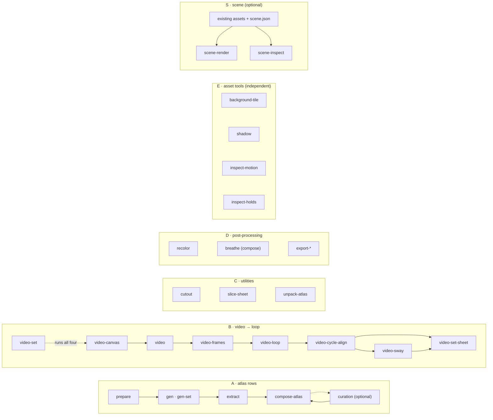

# sprite-gen documentation index

One CLI, two sprite pipelines, independent tool groups and optional scene creation.
Each doc owns one concern. Start with the result you want, then follow its contract;
the code domains describe ownership rather than an execution order.

| Pipeline / tool group / workflow | Entry doc | Verbs |
|---|---|---|
| **A · atlas rows** — one still becomes a runtime sprite sheet | [run-contract.md](run-contract.md) | `prepare` → `gen` / `gen-set` → `extract` → `compose-atlas`; optional `curation` and recompose |
| **B · video → loop** — one still becomes transparent motion loops | [video-pipeline.md](video-pipeline.md) | `video-canvas` → `video` (or `video-prompt` and a video MCP on your agent) → `video-frames` → `video-loop`, `video-set`, `video-cycle-align`, `video-sway`, the Sway layer (`video-sway-inspect` shows every cell of it and moves nothing; old names `video-follow`, `video-follow-inspect`), `video-set-sheet` (a set's directions on one sheet, on one ground line), `video-stop` (a walk or run that stops, from the clip's own start played backwards), `video-chain` (pieces of keyed clips on one canvas played as one move, at the time the caller gives); `handed-check` for an item on one side; obstacle plate painted and erased (`--prop-plate`) |
| **C · utilities** — imported images in, clean cuts out | [sheet-slicing.md](sheet-slicing.md) | `cutout`, `slice-sheet`, `unpack-atlas` |
| **D · post-processing** — finished sheets, refined | [recolor.md](recolor.md) | `recolor`, `recolor-palette`, breathing (compose, or `breathe` on a folder of frames), `export-pngs`, `export-aseprite` |
| **E · asset tools** — independent background, shadow and motion tools | [asset-tools.md](asset-tools.md) | `background-tile`, `shadow`, `inspect-motion`, `inspect-holds` |
| **S · scene** — optional composition of existing assets | [scene.md](scene.md) | `scene-render`, `scene-inspect` |

`sprite-gen --help` prints these separate catalogs and every verb grouped by domain; the
grouping is derived from `sprite_gen/_modules.py`, the one taxonomy table.

## User requests

| Doc | Owns |
|---|---|
| [user-workflow.md](user-workflow.md) | Two conversation flows, access checks, optional curation and saved defaults |
| [atlas-workflow.md](atlas-workflow.md) | Execution of GPT row sprites through the existing extraction pipeline |
| [Effects](effects.md) | `pixel-draw --kind effect`, `video-frames --alpha-mode brightness`, `video-loop --cycle lifetime` |

## Contract & structure

| Doc | Owns |
|---|---|
| [run-contract.md](run-contract.md) | The atlas pipeline's normative contract: stages, a flag against the file that holds the same key, the run-dir folder tree, curation-view display, atomic extract, concurrency scope |
| [architecture.md](architecture.md) | How the code is laid out: domains, stage ownership, the numeric SSoT, the cell model, extraction internals, runtime manifest |
| [loop-comparison.md](loop-comparison.md) | Final loop artifact digests, comparable quality axes and explicit unknown verdicts |

## Request authoring (pipeline A inputs)

| Doc | Owns |
|---|---|
| [states-and-frames.md](states-and-frames.md) | Which states to request and how many frames each |
| [subject-profiles.md](subject-profiles.md) | `character` vs `effect` subjects and the sparse-frame floor they set |
| [pixel-unfake.md](pixel-unfake.md) | The `fit` / `pixel_unfake` path for pixel-art targets and jitter-free locomotion |
| [chroma-alpha.md](chroma-alpha.md) | Choosing the chroma key and diagnosing alpha cleanup after extraction |

## Generation (the AI steps)

| Doc | Owns |
|---|---|
| [gen.md](gen.md) | `sprite-gen gen` / `gen-set`: providers, default resolution and what a default codex that cannot run turns into, transparency strategy per provider, where every direct provider call goes (`SPRITE_GEN_<PROVIDER>_BASE_URL`) and subscription logins off (`SPRITE_GEN_LOGINS`), when a refused provider request is sent again, row usage |
| [pixel-draw.md](pixel-draw.md) | `sprite-gen pixel-draw` (experimental): Claude Opus draws 8–48 px pixel art as a pixel grid — the inputs, the safe area, the style (`--style`), a set of up to 64 frames drawn four at a time and one motion (`--motion`), the run folder and its report, gates G1–G8, the row repair and the one redraw, the pick between candidates, Message Batches and `--resume`, re-rendering an edited `grid.txt` |
| [logo.md](logo.md) | `sprite-gen logo`: a title logo or wordmark lettered by the model into a title screen or poster, only its lettering redrawn on a chroma key, cut out with its glow kept — the steps, files, report, text check and refusals, the key choice, the logo matte and its known limit |
| [prompt-assembly.md](prompt-assembly.md) | What the engine adds to a still or clip prompt and when: the pieces, the 2.22.0 freeze without `--handed`, what counts as already said, and the notes on the caller's own words |
| [video.md](video.md) | `sprite-gen video` / `video-extend` / `video-edit` / `video-resume`: stills and clips to mp4 through Grok Imagine (image-to-video, last-frame pin, references, extension, editing, asking again for an unfinished generation) with the user's own credential |
| [video-pipeline.md](video-pipeline.md) | Pipeline B engine contract: state canvas, keyed frames, true-period and one-shot cycles, strip/GIF/WebP, a single play's root motion and its air retimed, obstacle plate painted and erased (--prop-plate), the batch, a set's directions on one sheet, a walk or run's stop |
| [loop-review.md](loop-review.md) | Automatic loop decisions, ambiguous gait review, visual evidence and explicit cut/alignment overrides |
| [loop-repair.md](loop-repair.md) | RIFE (its model, rife-v4.25 by default, and how to name rife-v4.6; where it runs, cost, licences, `sprite-gen rife install`, what runs without it), jump-frame repair, the flow reading (frames off a walk's way), the eased retime (a part that rushes on its way), the overlapped wrap (a part on its own beat at a two-step cut's wrap), the part pop (a hand or a foot that jumps at the wrap), the jolt index and its gate, one cycle length per direction set |
| [frame-interpolation.md](frame-interpolation.md) | Generative in-betweens for sprite frames, recorded as a take |
| [seamless-video-loop.md](seamless-video-loop.md) | Making a non-looping ambient clip loop forever (RIFE seam bridge) — a different job from pipeline B |
| [face-parts.md](face-parts.md) | Face requests, face packs, talking face rules, live player, `video-face`, and `face-bake`. |

## Curation

| Doc | Owns |
|---|---|
| [curation.md](curation.md) | The webview, standalone candidate view, finished-sheet editing and every `curation.json` field |
| [breathing.md](breathing.md) | The idle-breathing post-process layer and the static-pose row recipe |
| [locomotion-curation.md](locomotion-curation.md) | Manual selected cycles, clean GIF export |

## Post-processing (tool group D)

| Doc | Owns |
|---|---|
| [recolor.md](recolor.md) | Deterministic palette-swap bake, colourway pick, `variants/` and its report |
| [engine-export.md](engine-export.md) | Aseprite-compatible export for Phaser and Flame |

## Asset tools and optional scenes

| Doc | Owns |
|---|---|
| [asset-tools.md](asset-tools.md) | Background recipes, repeating RGBA tiles, projected shadows, shared asset formats and motion/contact measurements |
| [scene.md](scene.md) | Scene spec, planes, camera, lighting, measured stride application, render/inspection and output contracts |

## Specialized inputs (tool group C and direction runs)

| Doc | Owns |
|---|---|
| [directional-anchor-workflow.md](directional-anchor-workflow.md) | Directional / 45° rows: base → direction anchors → rows, the left-right gate |
| [sheet-slicing.md](sheet-slicing.md) | Multi-figure grid sheets to per-cell standing cuts, the alpha haze cleanup of a transparent sheet; the `cutout` routes |

## QA

| Doc | Owns |
|---|---|
| [qa-motion.md](qa-motion.md) | Motion Continuity of an image row (Pipeline A) — the blocking judgement of a row as motion |

## Runtime & process

| Doc | Owns |
|---|---|
| [capabilities.md](capabilities.md) | `sprite-gen capabilities`: every verb and argument as one JSON line read off the CLI's parser, the providers each verb may call and be billed by, the provider address and login variables |
| [interpreter.md](interpreter.md) | Why the project venv is the only interpreter (no global `python3`, no NumPy fallback) |
| [rename-gate.md](rename-gate.md) | What must move together when a vocabulary word or key is renamed |
| [release.md](release.md) | How a vX.Y.Z tag becomes a release page, what the lane builds and the publisher attaches, and what stays manual |
| [troubleshooting.md](troubleshooting.md) | Symptoms of a pipeline that is "quietly wrong", with causes and fixes |
