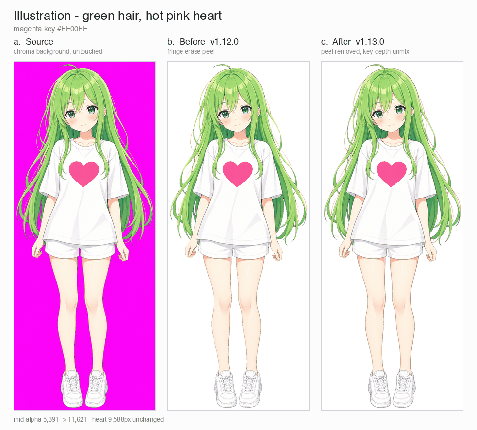
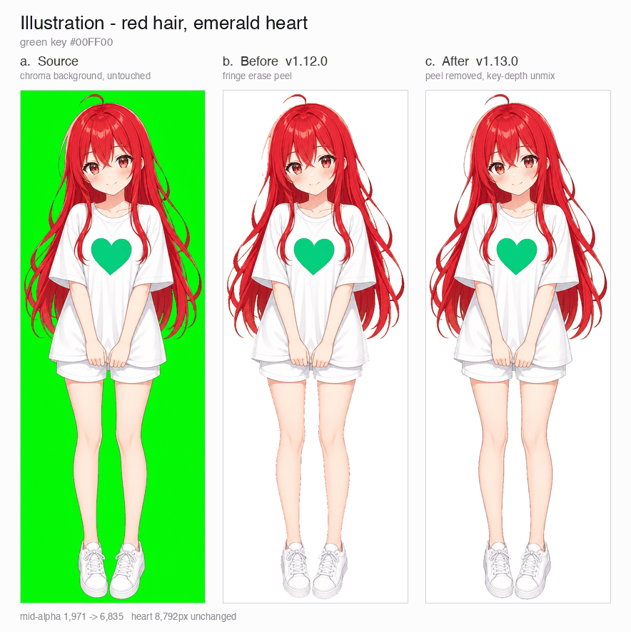
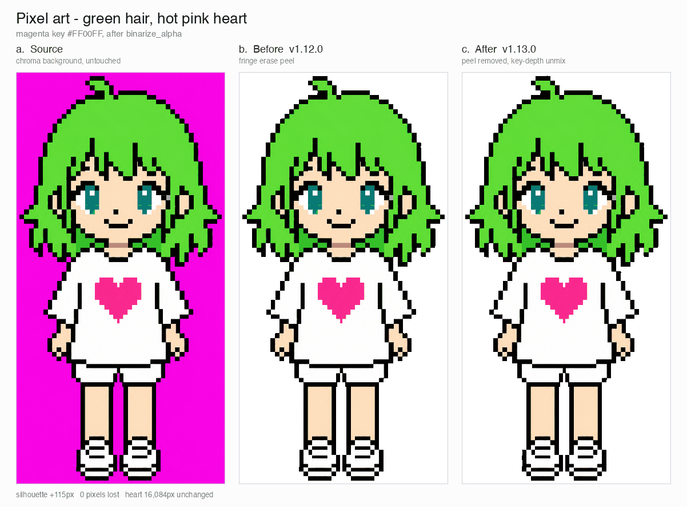
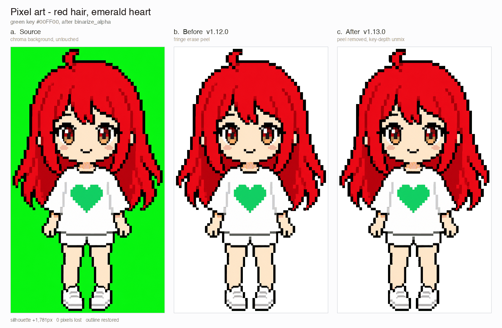
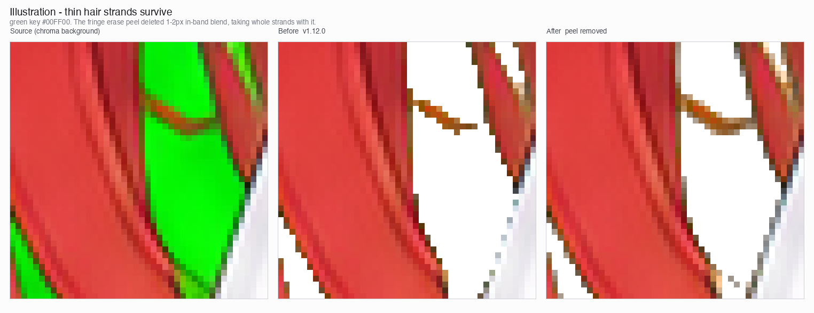
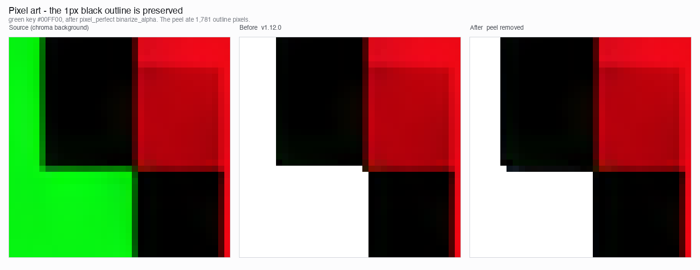

# Chroma Key & Alpha Cleanup — sprite-gen reference

> Owns: Choosing the chroma key and diagnosing alpha cleanup after extraction · Index: [docs/README.md](README.md)

## Why the extractor unmixes instead of peeling (from the README, 2026-09-09)

The extractor keeps chroma cleanup deterministic: soft-alpha unmix preserves antialiased hair strands and thin outlines instead of peeling them away before coverage can be solved.

   
  <em>Illustration, magenta key: source, v1.12.0 peel, v1.13.0 soft-alpha unmix.</em>

   
  <em>Illustration, green key: source, v1.12.0 peel, v1.13.0 soft-alpha unmix.</em>

   
  <em>Pixel art, magenta key: source, v1.12.0 peel, v1.13.0 binarized output.</em>

   
  <em>Pixel art, green key: source, v1.12.0 peel, v1.13.0 binarized output.</em>

The close-up crops below show the edge detail behind the full-body comparisons.

> `SKILL.md` 허브에서 분리한 시나리오 상세. 크로마 키를 고르거나(특히 소재색이 키와 인접할 때), 추출 후 소재색 손실을 진단할 때 이 문서를 따른다. 분기표 SSoT 는 image-gen SKILL.md 최상단 게이트이고, 이 문서는 그 규칙의 sprite-gen 쪽 상세다.

## Key selection

`prepare_sprite_run.py` chooses a chroma key by sampling the base image unless the request forces one. The generated character must not use the chroma color or chroma-adjacent colors.

**Choose the chroma away from the subject's dominant hue — do not blindly default to magenta.** The hard key erase is a color-distance ball (`--key-threshold`, default 96) around the key **and** around the background colour the generator actually painted (detected from the flat borders, `detect_background_key_rgb`; since 2026-09-11 — generators paint `#00FF00` as (8, 162, 24) or darker and the pure-key ball alone missed it): a subject color inside either radius is deleted no matter where it sits, so the darker the generator painted the key, the deeper into the key's dark variants (olive under green, plum under magenta) the erase reaches. Antialias fringe is no longer erased by a separate peel; key/subject boundary blends are **unmixed into despilled RGB + partial alpha** when they are close enough to the keyed region. In-band blends are limited to key-distance `<= 2`, out-of-band blends use `--fringe-unmix-reach` (default 4), and deeper key-tinted *interior* subject colors (hot pink / purple under a magenta key) survive byte-identical. Small strongly key-tinted clusters buried inside the subject (generator spill) are despilled in place — see below. Key choice still decides quality:

- Pink / purple / magenta-family subjects (꽃, 씨앗봉투) → use **green** `#00FF00`; their edge blend under a magenta key wastes real silhouette pixels.
- Deep-red / crimson / wine hair or clothing is **magenta-adjacent** (both high R). Use **green** for red/crimson/warm subjects.
- Green/teal/olive subjects → use **magenta**.
- Blue subjects → avoid cyan/blue keys; magenta or green.
- Both pink *and* green in one subject → pick the key farther from the larger/more important material, verify both survive after extraction, and prefer `--chroma-key auto` (distance-scored).

**The border and the interior answer different questions** (2026-09-12). `detect_background_key_rgb` classifies the border samples with `is_border_key_candidate` (keyed channels lit, the darkest unkeyed channel dark (< 64) and under 35 % of the brightest keyed channel, the brightest unkeyed channel under half of the brightest keyed channel, with the half bound explained in the 2026-10-21 paragraph that follows, no balance between the keyed channels) because a flat border is already background evidence: Grok paints `#FF00FF` as (216, 46, 147), blue/red 0.68, which the interior rule `is_key_family` (balance ≥ 0.8) rejected, so the detector fell back to the declared key and the whole background survived. The interior rule keeps the balance so hot pink (250, 77, 150) and purple (213, 112, 246) inside the subject stay byte-identical; they fail the border rule too, on the lit green channel. The painted key's erase ball only reaches pixels that carry the signature or are 8-connected to them through the ball (the antialiased rim) — an isolated look-alike patch inside the subject is not erased. `cutout --key auto`, `video-canvas --key` and the `video-frames` residual split use the same border function.

**The border rule accepts green leaning toward cyan or yellow** (2026-10-21). Before this change the border rule was: everything the interior rule `is_key_family` admits, or a colour with every keyed channel lit (>= 64), every unkeyed channel dark (< 64) and every unkeyed channel at most 35 % of the brightest keyed channel. The dark bar of 64 was set between magentas: the magenta key has one unkeyed channel (green), and that channel is what tells a painted magenta key from hot pink (250, 77, 150) and purple (213, 112, 246), whose green is lit (77, 112). The green key has two unkeyed channels (red and blue). A green screen leans on one of them. The studio chroma-key green `#00B140` is (0, 177, 64): its blue sits on the bar, not under it. (0, 200, 90) leans further toward cyan. Neither is interior family either (blue is over 35 % of green). Both sit more than 96 from pure green (100.9 and 105.5), so with the detector falling back to the declared key, the whole background survived the hard cut. Under `video-frames --spill auto` choosing `full`, the surviving background was then treated as spill on the subject and despilled to a blue-grey instead of being erased. The rule now: for the unkeyed channels, the darkest keeps the old bars (< 64, and at most 35 % of the brightest keyed channel), and the brightest only has to stay under half of the brightest keyed channel (`_BORDER_KEY_MAX_LEAN_RATIO`, 0.5). Under half means the hue sits nearer the key than the neighbouring secondary colour: green is at 120 degrees, yellow at 60 and cyan at 180, so the midpoints are 90 and 150. The lean is accepted in both directions: toward cyan (blue lit, e.g. (0, 200, 90)) and toward yellow (red lit, e.g. (90, 210, 0)). A key with one unkeyed channel (magenta) is unchanged: its darkest and brightest unkeyed channel are the same channel, so it still has to be under 64, and hot pink and purple are still refused on their lit green. Over the whole RGB cube, the magenta candidates are exactly what they were; for green nothing is dropped, and every added colour has a hue strictly between 90 and 150 degrees. Still refused for green: ivory (248, 247, 242), cyan (0, 255, 255), teal (0, 128, 128), sea green (46, 139, 87), a grey-green with both unkeyed channels lit (70, 200, 90), and a green exactly at the cyan midpoint (0, 200, 100), where blue is half of green. The painted key's erase ball is unchanged in shape: inside the ball it erases the pixels that carry the signature and whatever is 8-connected to them through the ball (the antialiased rim). A rim made of brown blended into a leaning green is cut with the background; the same blend buried inside the subject stays. The lean is evidence about the background that leans. So inside the frame, the lean widens only the erase ball of a painted colour that leans itself (`extract._painted_key_leans`: the painted colour is a border candidate only through the lean). For a painted colour that does not lean, the ball's seeds and the edge-contact split use the signature with every unkeyed channel dark, which is the border rule as it was before (`_border_key_candidate_field(..., lean=False)` is that rule, colour for colour, over the whole RGB cube). The detector reads the lean second. It first counts, on their own, the candidates the rule admitted before the lean. When those make up at least 12% of the samples, it returns the mean of their most populated bin, which is exactly the colour it returned before the lean. Below 12%, the samples only the lean admits join them, but their most populated bin gives the colour only where the declared key's own cut would leave that background on the border. Two conditions, both needed: the samples only the lean admits that lie farther from the declared key than the cut (the radius the caller keys with: `threshold`, which the engine sets from `--key-threshold`, 96 by default), in that most populated bin or in a bin beside it on every channel, make up at least 2% of the samples; and the candidates outside that bin and the bins beside it make up less than 12% of the samples (the border holds one key-coloured background). Otherwise the declared key is kept, as before the lean. A leaning border the declared key clears by itself gains nothing from the leaning colour; its ball would only reach further into a subject near that colour. The 2% keeps the soft rim where a subject meets an edge of the frame (its blend with the background crossing the cut there) from being read as background the cut left; and a background whose tail past the cut is under 2% of the border keys as before the lean, the few pixels past the cut included. A second key-coloured colour on the border may be the subject's own (a leaf running along an edge, or another green); read as part of the background, it would let the ball take a subject colour near the dominant one. The detector takes the cut as a `threshold` argument; the engine (`remove_chroma_background`), `cutout`, the reference window `video-frames --spill auto` keys, and the YCbCr path's decontamination pass hand it the radius they key with. Read together, leaning samples would move the colour found on a border the old rule already recognised. A sample admitted only through the lean can share the 8-wide bin of such a background and move its mean: (0, 200, 71) in the bin of (0, 200, 64) would move it to (0, 200, 65). A teal subject (0, 154, 149) sits 96.65 from (0, 200, 64), just outside the painted ball (radius 96), and 95.77 from (0, 200, 65), inside it, so the ball would erase all of it. Leaning samples in a bin of their own, such as (0, 200, 90), that outnumber the background would take the mode. A colour found the first way never leans itself: magenta has no lean (one unkeyed channel), and for green the floor of the mean of one 8-wide bin of those candidates is always one of them (checked over every bin). So the painted ball in the hard cut, the subject window the spill judgment keys and the `video-frames` edge-contact split read it exactly as they did before the lean. Consequence: under the same key, every image is keyed either exactly as before the lean or exactly as with the leaning colour read. As before the lean: wherever the rule before the lean recognised the border (its candidates at least 12% of the corner and border samples), it keys byte for byte as before, whatever leaning green is mixed into that border, in the background's own bin or in another, and in whatever share; wherever the declared key's cut clears a leaning border by itself; and wherever the border holds a second key-coloured colour. With the leaning colour: where the key's cut leaves the border's one leaning background. A leaning-green part of the subject on the corners and the border can be taken as the painted colour only where the candidates of the rule before the lean make up less than 12% of the samples, the key's cut leaves it, and no other key-coloured colour holds 12% of the border: that is, only where the subject crowds the border. A leaning-green patch such as (0, 160, 75) or (10, 120, 50) buried in the subject on (8, 162, 24) is kept. On a background that leans, a patch inside the subject that leans with it and sits within 96 of it is keyed, as any signature colour inside the painted ball is. On a leaning background, subject colours within 96 of the painted colour and joined to the background are keyed with it (for example sea green (46, 139, 87) or teal (0, 128, 128) on (0, 200, 90)), the same ball the engine uses for every painted key; on the already supported (8, 162, 24), leaf (60, 140, 60) and sea green joined to the background are keyed the same way. Colours off the key, such as brown, skin, highlight, hot pink, purple, ivory, cyan and turquoise, are not keyed on any of these backgrounds. `cutout --key auto` and `video-canvas --key` classify the flat corner colour with the border rule, lean included, because there the question is what the painted colour can be. A corner colour the old rule took routes as before; a leaning corner colour now routes to green. The detector applies the lean only second, as above, and only where the declared key's own cut leaves the border's one leaning background. One function still classifies the border everywhere: `detect_background_key_rgb`, `cutout --key auto`, `video-canvas --key` and the `video-frames` edge-contact split, as well as the painted ball in the hard cut and the subject window the spill judgment keys, but the ball, the subject window and the `video-frames` edge-contact split take the lean only from a painted colour that leans (the edge-contact split reads the frame's painted colour).

## `--chroma-key auto`

When unsure, let `--chroma-key auto` sample the base. It excludes the detected flat opaque chroma background from subject scoring, then scores candidates by distance from the remaining subject pixels. `auto` refuses a key whose nearest subject pixel falls inside the erase radius when a safer candidate exists, records candidate `score`, `min_subject_distance`, `clears_erase_radius`, and `background` metadata in the request, and warns (stderr) when no candidate clears the subject — so a small but critical feature (eyes, a gem, an ear lamp) under 1% of the pixels is not silently deleted. Only force a key when you know the subject hue is safely far from it. Verify after extraction that the dominant subject color survived — a black-where-it-should-be-colored frame means the key was adjacent to the subject.

## Extraction-side alpha cleanup

`extract_sprite_row_frames.py` owns alpha cleanup for sprite rows. Three passes, in order:

1. **Hard key cut** — pixels within `--key-threshold` of the key *or* of the painted background colour detected on the borders (`detect_background_key_rgb`; `background_key=` pins it explicitly) — and already-transparent input — are erased; alpha=0 pixels get their RGB cleared to `(0,0,0)` (no halo).
2. **Soft-alpha unmix** — key-tinted blends near the keyed region are separated into despilled RGB + **partial alpha**: the blend model `observed = (1-k)·subject + k·key` is solved from the key-tint score, so antialiased silhouettes keep their coverage ramp instead of collapsing into a binary staircase. In-band blends (inside `--fringe-key-threshold`) are eligible only at key-distance `<= 2`; out-of-band blends use `--fringe-unmix-reach` (default 4). This preserves deeper key-tinted material while fixing trapped blend pockets between hair strands.
3. **Trapped-spill despill** — a small connected cluster of key-tinted pixels (≤ `--spill-max-fraction` of the subject, default 0.005) containing at least one strongly tinted pixel is generator spill, wherever it sits: its color is corrected in place with alpha kept (no pinholes). Large key-tinted regions are intentional material and are never touched; marginally warm subject colors (skin) never qualify.

A fourth pass, edge decontamination (`decontam`, below; on by default in `video-frames` and `video-set`, off elsewhere), then re-explains the edge with the subject's own colours.

The unmix/spill tunables live in the run's `sprite-request.json` under `chroma` (`unmix_reach`, `spill_max_fraction`) — the extractor reads them from there, CLI flags override, and the effective values are written back to the request so every run records what produced it. Then it extracts connected components and writes fresh transparent cells. The pixel-unfake path is unaffected: it binarizes alpha downstream (α ≥ 128 → opaque), so soft-alpha input degrades gracefully. This is intentionally closer to hatch-pet than to simple `magick -transparent`.

If component extraction cannot find the declared frame count, the row is blocked. `--allow-slot-fallback` exists for explicit debugging only; it must be reported as `slots-explicit` and is not the default path.

## `chroma.mode: "ycbcr"` — chrominance-plane matting (opt-in)

Port of perfectpixel-studio's `chroma.go` (MIT, see NOTICE). The default RGB path above classifies pixels by RGB distance to the key, so a *shaded or gradient* key background (dark green under a green key) or JPEG 4:2:0 chroma noise can drift past the erase radius and survive. The ycbcr path ignores luma entirely and separates on the CbCr plane, where shading does not move the key cluster:

1. **Key detection** — CbCr histogram *mode* of corner patches + thin borders (never a mean — a mean drifts on gradients); when enough border samples sit in the declared key's chroma family, that cluster wins outright.
2. **Soft matte** — Hermite smoothstep alpha ramp over CbCr distance (24 → 72).
3. **Despill** — subtracts only the key-direction chroma component inside the despill band; colors orthogonal to the key keep their saturation.
4. **Border flood fill** — 4-connected from the image borders through lenient key-chroma pixels; interior key-family pixels (gems, highlights) never connect and survive.
5. **Self-diagnostic rematte** — an opaque-fraction spike (subject erased) or declared-key residue spike (background survived) triggers a rematte with the declared pure key; the better result wins and the fallback is reported via extraction warnings (never silent).
6. **Dots and pinholes** — on the matte that won, a lone pixel (opaque, with no opaque pixel among its eight neighbours: `isolated_dots`) is erased and a clear pixel with seven or more opaque neighbours is filled; soft edges are left as they are. A pixel that touches another only at a corner is joined to it, as in every component the engine reads. `isolated_dots` is the one judgment of a lone pixel: [`pixel-draw`](pixel-draw.md#gates)'s G5 counts a drawn grid's stray pixels by it.

Select with request `chroma.mode: "ycbcr"` or `--chroma-mode ycbcr`. **The default stays `"rgb"`**: on clean flat-key raws the RGB path's exact-solve unmix already removes key tint completely, while ycbcr's fixed-scale despill leaves a small tinted soft-edge halo — ycbcr is for degraded sources (shaded/gradient backgrounds, JPEG chroma noise), not a general upgrade.

## `decontam` — give the edge the subject's own colour back

The unmix above separates a blend by its key-tint score, and that assumes the subject's own colour carries no tint (grey, white). A saturated subject breaks the assumption. A crimson hair strand blended a third of the way into green scores as barely tinted, so it stays opaque and olive; where the full spill pass does reach it, the `1/(1-k)` gain of `despill_color` turns it orange. Video adds a second loss: H.264 4:2:0 has already averaged the key into the chroma of every strand one or two pixels wide. Its luma survives at full resolution.

`decontam: "palette"` re-explains the edge after the matte (either matte). It learns a 32-colour palette from the subject's confident interior (opaque, deeper than 6 px) and fits every subject pixel within 6 px of the keyed background (the still fit also fits every keyed pixel within 3 px of the subject; the video fit fits the subject pixels only), as

    observed = alpha · P + (1 − alpha) · B

B is the key background measured locally (mean of keyed pixels within 12 px). P is the palette colour whose line through B passes closest to the observation, and alpha is the projection onto that line. The colour written is P's chroma at the observation's luma: the hue comes from the subject, the light and shade from the pixel. When the subject owns no key-hued material (≤ 0.5 % of its interior carries the key hue, the same test `video-frames --spill auto` runs on its reference still), the palette is key-free, so the output cannot carry the key's hue and no channel is amplified.

| The pixel | Outcome |
|---|---|
| no palette colour explains it (a colour the interior never shows), or, in the still fit, the explanation misses its luma (outline ink darker than any blend) | engine bytes |
| closer to a palette colour than the blend explains it (margin 10, or 3 noise sigmas of the background): as observed, or, in the still fit, at its own luma within the subject's own spread (below), which then also raises the margin | engine bytes, except where the still fit finds that the matte changed it although it carries no key hue: then its own colour and coverage come back. With a key-free palette, a leftover key hue (every keyed channel above every other by more than 8) loses the excess beyond 8 on its keyed channels, which never raises a channel and leaves colours without the key hue alone (a red or a skin tone under magenta is not magenta) |
| still fit: deeper than a still's antialiased edge (2 px, the engine's in-band unmix depth) without the key's hue, or on that edge without it and with the colour (at its own luma) of the material right behind it | the subject's own colour, never a blend or a tint; its own colour and coverage come back where the matte changed it |
| video fit: with a key-free palette, a band pixel within 6 px of a key-coloured part (opaque, deeper than 6 px, key hue above 8) | keeps the matte's bytes, and the key-hue cap leaves it alone |
| video fit: a band pixel whose colour, as observed or at its own luma, is within the opaque margin of the mean colour of the subject right behind it (subject pixels deeper than 2 px, within a 3 px box radius) | that material continued to the edge, not a blend or a tint: keeps the matte's bytes (the key-hue cap still applies) |
| pushed toward the key clearly more than the fit misses by, but not proven partial coverage (in the still fit, not when a shade of a palette colour explains it within the spread) | colour only |
| a blend within the unmix reach (`chroma.unmix_reach`, default 4) | alpha and colour |
| a blend deeper in the 6 px band | colour only, so a key reflection on a solid surface is recoloured rather than made see-through |
| still fit: a keyed pixel within 3 px of the subject that fits a blend above the background's noise floor and chains to the subject | coverage recovered: the faint sides of a strand the hard cut erased |
| video fit: a keyed pixel within 3 px of the subject | stays transparent: the video fit recovers no flank coverage |
| video fit in a clip: each test at that pixel, unless this frame's evidence passes the test's bar the other way by 16 (an RGB distance, `VIDEO_HOLD`); and the palette colour picked in the previous frame, unless another palette colour's line passes closer by 16 | hold: keeps the outcome and palette colour it had in the previous frame |
| video fit in a clip: every pixel the pass examines, as its call or palette colour changes; a still pixel whose source moved by at most 8 in any channel anywhere in its 3x3 box (`VIDEO_STILL`) | blend: mixes this frame's matte and fit renderings, moving toward this frame's call by at most 0.2 a frame (`VIDEO_BLEND`) and by less when needed to limit the premultiplied output change to 4 (`VIDEO_STEP`) plus 0.25 (`VIDEO_STEP_MOTION`) per unit of source movement; a still pixel whose mix moved, is still changing, or entered or left the band moves at most 4 a frame from its previous output, and a pixel keyed in this frame stays transparent |
| video fit in a clip: a pixel written in this frame and the previous one in the same palette colour, whose mix is at its call in both frames and whose source moved by at most 8 in any channel anywhere in its 3x3 box (`VIDEO_STILL`) | settle: moves a tenth of the way (`VIDEO_SETTLE` 0.1) from its previous value toward this frame's fit, stays within 12 per channel (`VIDEO_SETTLE_REACH`) of that fit, and moves at most 4 a frame when it has to catch up to get within 12 |
| `video-frames`: within its edge band (4 px of the top, left and right edges), a pixel the matte left transparent | stays transparent: the pass adds no edge contact to a clip (below) |

Interior pixels are never touched, `off` returns the engine's output byte for byte, and everything is integer-exact or a fixed sequence of float64 operations (no random seed, no iteration-order dependence). The palette is a histogram k-means with a greedy weighted farthest-point seed and a fixed iteration count. There is no new dependency.

Licensing: the pass is plain numpy inside this Apache-2.0 repository and installs nothing. Learned matting was considered as an optional install: BiRefNet and ViTMatte (MIT) and MODNet (Apache-2.0) are compatible, while RMBG-2.0 (non-commercial) and Robust Video Matting (GPL-3.0) cannot be dependencies. None was adopted: on the ground-truth set below, the two that were measured (BiRefNet-lite and ViTMatte-S alphas with foreground estimation or this repaint) left more key contamination than this pass, and each needs a model download.

**The frame edge.** A decoded frame's blur runs the subject on into the key as a smooth tail, and the pass reads that tail as a faint blend at every distance, on the keyed ring just past the flank as well as on the flank, so no floor tells a strand's side from it. The video fit now gives keyed pixels no coverage at all, so its frame-edge band holds by construction there. Along the frame's top, left and right edges it decides a clip: `video-frames` refuses one where any visible pixel in its edge band has key colour in the source, as the key surviving the matte, so a head a few pixels under the frame edge would pass with the pass off and fail with it on. `video-frames` therefore hands the pass its edge band (`decontam_edge_band`, the gate's `EDGE_ROWS`), and there a pixel the matte left transparent stays transparent. The still fit's flank keeps what it recovers.

Two fits. `still` chooses P per pixel. `video` chooses P on a 3x3 mean of the observation, whose chroma is blurred anyway, and averages the projection alpha with a luma-only alpha where P and B differ in luma. `video-frames` uses the video fit and learns one palette per clip on the first frame, so the colours an edge may take cannot change from frame to frame; with `--prop-plate` it learns it without the plate's place on that frame ([prop plate](video-pipeline.md#prop-plate---prop-plate)). In a clip, `video-frames` keeps a history across frames, so a frame's bytes depend on the frames before it in the order they were given. This stops the edge of a still subject sparkling from frame to frame when codec noise shifts pixels across the pass's tests and palette choices. With hold, each test keeps the outcome it had at that pixel in the previous frame until this frame's evidence passes the test's bar the other way by 16 (an RGB distance, `VIDEO_HOLD`), and the palette colour picked in the previous frame stays unless another palette colour's line passes closer by 16. With blend, every examined pixel mixes this frame's matte rendering, with its key hue capped, and this frame's fit rendering, moving toward this frame's call by at most 0.2 a frame (`VIDEO_BLEND`) and by less when the premultiplied output change would exceed 4 (`VIDEO_STEP`) plus 0.25 (`VIDEO_STEP_MOTION`) per unit its source moved in its 3x3 box. A still pixel whose mix moved, is still on its way to its call, or came into or left the band moves at most 4 a frame from its previous output; a pixel keyed in this frame stays transparent. With settle, a pixel written in both frames in the same palette colour, whose mix is at its call in both frames and whose source moved by at most 8 in any channel anywhere in its 3x3 box (`VIDEO_STILL`), moves a tenth of the way (`VIDEO_SETTLE` 0.1) from its previous value toward this frame's fit and stays within 12 per channel (`VIDEO_SETTLE_REACH`) of that fit, catching up at most 4 a frame where needed.

**Gold and yellow.** Gold sits between red and green, so a gold a little darker or yellower than the palette's own also fits as a warmer palette gold with some green mixed in. Up to v2.10.1 the still fit took that reading, and gold edges and small gold drops came out orange and partly see-through. Since v2.10.2 the still fit weighs the blend against the subject's own colour at the pixel's own light (the freedom the written colour already has), and a blend has to win by more than the subject's own spread: the 99th percentile of how far its confident interior sits from the palette, large for a textured gold and small for flat colour. A still's antialiased edge is at most two pixels deep, so deeper in the band a key share has to show as the key's hue: a pixel without it is the subject's own colour, and so is an edge pixel without it that has the colour of the material right behind it. Where the matte changed such a pixel, the source colour and coverage come back. The RGB matte (`cutout`'s default) needs that: it scores key tint on the channel average, which calls yellow green, so it unmixes gold as if it were a blend; the YCbCr matte (`gen`) does not. The video fit keeps its decisions, because a decoded frame's chroma is blurred and an edge pixel's colour is no evidence of what the subject is made of there.

Three modes: `palette` runs the pass and fails loud where it cannot (no key hue, or no subject pixel deeper than 6 px to learn from); `auto` runs it wherever it applies and records why not elsewhere; `off` leaves the matte as it is.

| Entry point | Default | Flag |
|---|---|---|
| `sprite-gen cutout IMAGE` | `off` | `--decontam off\|auto\|palette` (chroma routes; on the white matte `auto` records that it has no key colour and `palette` is refused) |
| `sprite-gen gen … --transparent` | `off` | `--decontam off\|auto\|palette` (chroma strategy; `auto` leaves native alpha alone, `palette` is refused before the provider is called when it cannot apply) |
| `sprite-gen video-frames`, `video-set` | `auto` | `--decontam off\|auto\|palette` (where `auto` cannot run it leaves frames as keyed and records the reason; with brightness alpha `auto` means off and `palette` is refused) |
| row extractor (`extract`, `inspect`) | `off` | request `chroma.decontam`, or `--decontam` to override; written back to the request once in play |

Reports record what the pass did under `decontam`: mode, whether it applied (and why not), fit, the palette and its material spread, and changed / refit / tint / recovered / unexplained / restored pixel counts.

Measured on a procedural ground-truth set (red strands 0.5–3 px wide, outline and interior ink, highlights, translucent wisps, white cloth and a gold accent on a painted green key; a still, and an H.264 4:2:0 round trip at CRF 16). Key contamination counts edge pixels covered in both output and truth whose hue turned 12° or more toward the key (green residue and the despill's warm drift both turn that way), or, on near-grey truth, whose a*/b* moved toward the key by 8. Halo is the mean CIEDE2000 against the true composite on #0A0A0D and on white:

| Source | Path | Key contamination | Halo dark / white | Strand recall |
|---|---|---|---|---|
| still | RGB engine (default) | 22.5 % | 6.65 / 7.16 | 84.3 % |
| still | RGB engine + `decontam` (still fit) | 0.03 % | 1.08 / 1.09 | 99.0 % |
| still | YCbCr matte (`gen`) | 19.1 % | 9.77 / 9.36 | 77.3 % |
| still | YCbCr matte + `decontam` | 0.12 % | 1.09 / 1.08 | 99.0 % |
| H.264 frames | RGB engine + `--spill full` | 33.2 % | 12.79 / 12.43 | 82.1 % |
| H.264 frames | + `decontam` (video fit) | 10.8 % | 9.38 / 8.73 | 91.4 % |

The two still-fit rows are v2.10.2's; v2.10.0 measured 0.07 % · 1.14 / 1.14 and 0.16 % · 1.15 / 1.14 on the same set, with the same recall. The video-fit row was measured in September 2026 with the video fit as it was then, which recovered the keyed flank, and has not been re-measured since flank recovery was dropped because that benchmark's inputs and tools are not at hand. The still-fit rows of that table are unchanged, and the scene table under Defaults has the current video fit's numbers.

**Defaults.** `sprite-gen video-frames` and `video-set` default to `--decontam auto`. Stills (`cutout`, `gen`) are `off`, because the still measurements use a green key. The row extractor (`extract`, `inspect`) is `off` because its frames are a derived cache that `heal` re-derives from raw, so a changed default would silently rewrite every existing run, and pixel-art rows binarize alpha downstream anyway. Two caveats on the video default: the pass was benchmarked on a green key only, and the video fit is less decisive than the still fit (10.8 % residual key contamination against 0.03 % on the benchmark above). No blocking defect is known. Video defaults to `auto` because on a chroma key, H.264 4:2:0 chroma mixes the key into every strand one to three pixels wide, leaving an olive rim on red hair over green with the pass off, and the pass gives such edges the subject's own colour back. The video fit does no flank recovery: it examines only subject pixels within 6 px of the keyed background. It holds calls, blends changes of call, and settles still pixels across frames so still edges do not sparkle: on a still scene under decoder noise (red strands on painted green), the mean change of each keyed edge pixel from one frame to the next on a dark background was 2.34 with `off` (99th percentile 8.3), 2.27 with hold and settle only (8.3), and 2.25 with hold, blend and settle (8.0); key contamination was 6.5 %, 2.3 % and 2.4 %, respectively. Where `auto` cannot run, it leaves frames exactly as the matte keyed them and records the reason in the report (`decontam.reason`, and per frame in `rows[].decontam`): a white key ("the white matte has no key colour to remove") or a subject with no pixel deeper than 6 px inside the keyed silhouette ("no interior to learn the subject's colours from"). With `--alpha-mode brightness` (emitted light on black, no chroma key), `auto` simply means off and records `decontam: {"mode": "auto", "applied_frames": 0, "reason": "brightness alpha has no key colour to remove"}`, while an explicit `--decontam palette` is refused. `--decontam off` keeps the matte as it is: the frames are exactly the bytes the matte keyed. On stderr after its JSON summary, `video-frames` prints a one-line warning starting `video-frames: warning: decontam auto ...` when `auto` did not run on any frame (naming the reason and stating that frames match `--decontam off`), when `auto` skipped some frames, when the subject owns key-coloured material so the palette is not key-free (edges may be repainted in the key colour too), or when the key-coloured part guard kept edge pixels beside a small key-coloured part (stating how many, and that a thin detail of that colour farther out may be repainted); codec noise deep inside the subject guards no edge and raises no warning, brightness alpha prints no warning, and the line ends by naming `--decontam off` as the way to keep the matte as it is. `video-set` lists the same line prefixed by the item name under `warnings` in its set report. On an Intel i5-7500 (1080x1920 synthetic clip, CRF 18, `--spill small`, six frames, one process per run), keying took 1.14 s a frame with `off`, 3.25 s with hold and settle only, and 3.36 s with hold, blend and settle; peak memory was about 400 MB, 945 MB and 1155 MB, respectively, which is about 365 MB more than `off` per megapixel of frame; `video-set` keys three items at once by default, so at that size it can use about 2.3 GB more than `off` at a moment. Changed pixels are about 2.4 % of each frame (4.7 % in the translucent scene), all within 6 px inside the silhouette; nothing outside it changes, and the interior is byte-identical.

| scene | key contamination | halo dark / white | strand recall |
|---|---|---|---|
| red strands 1 to 3 px on painted green | 24.2 % to 10.2 % | 11.6/12.1 to 9.6/10.1 | 91.4 % to 91.4 % |
| the same on pure #00FF00 | 27.4 % to 10.9 % | 12.0/11.9 to 10.0/9.9 | 92.4 % to 92.4 % |
| red hair on magenta | 3.4 % to 0.5 % | 15.0/19.6 to 12.7/16.4 | 87.0 % to 86.9 % |
| red hair on Grok's darker magenta | 5.4 % to 1.8 % | 20.7/31.5 to 19.3/30.0 | 73.3 % to 73.2 % |
| a translucent glow and a cyan wisp | 20.6 % to 8.8 % | 12.6/9.4 to 11.7/8.5 | 85.7 % to 85.4 % |
| a small green charm (0.04 % of the interior) | 23.8 % to 11.4 % | 11.8/12.9 to 10.0/11.1 | 90.7 % to 90.7 % |

On these moving scenes, key contamination is about one point higher than with hold and settle only: a changed call takes a few frames to reach the fit's colour, where the previous version switched at once.

Strand recall no longer rises with the pass because that gain came from the flank the video fit no longer recovers; halo gains are smaller for the same reason (on Grok's darker magenta, 19.3/30.0 now against 17.1/24.7 with the flank, off 20.7/31.5). On the small green charm, the share of key-coloured edge losing half its key hue or coverage was 0.77 with `off`, 1.00 without the guard in the diagnosis, 0.82 with hold and settle only, and 0.82 now (colour error 41.7 with `off`, 64.9 without the guard, 46.2 with hold and settle only, and 45.6 now). On the two magenta keys, red hair counts as key-coloured material so the palette is not key-free, the warning line appears, and outline ink CIELAB error goes from 19.3 with `off` to 20.2 now on magenta (20.8 with hold and settle only) and from 21.7 to 22.6 on Grok's darker magenta (24.1 with hold and settle only); a white key and a subject with no interior produce identical bytes to `off`, with the reason recorded. Reports add `decontam.reason` (first skip reason), `decontam.skipped_frames` when frames are skipped, and per-frame stats and clip totals add three counters, `held_px` (pixels where a held outcome or colour differed from what that frame alone would have given), `blending_px` (pixels showing a mix of two calls, not yet at this frame's call), and `settled_px` (pixels the settle or a still step moved from the previous frame's output), alongside `key_part_kept_px` and `behind_kept_px`, while `recovered_px` is now 0 in video.

Limitations:

- An edge takes one of the subject's interior colours at its observed brightness. A thin feature whose colour appears nowhere inside the subject keeps the engine's pixels. On the RGB matte that includes the matte's reading of a thin yellow line or dot, with no pixel deeper than two pixels, as a green blend.
- In video a thin strand's chroma is gone before keying, so its colour is chosen from blurred chroma; strands come back in the hair's hue, sometimes a shade darker or paler than drawn.
- The hold works on pixels that stay put. A strand that moves is decided afresh in every frame, and its change of call is spread over a few frames while both renderings follow it, so a moving edge still changes from frame to frame as its colour does; a red rim moving over a dark background changes more than the olive rim `off` leaves, and pixels whose call changes show a mix of the two for a few frames.
- The settle follows a slow change within 12 levels per channel and catches up past that at most 4 a frame.
- A change of call on a still edge arrives at most 4 a frame. The largest change, from the matte's full coverage to a faint fit or back, can take up to about 64 frames, about 2.7 s at 24 fps; in between, the edge shows a mix of the matte's colour and the fit's.
- The video fit gives back no coverage the hard cut keyed: the outer pixels of a soft edge that the cut erased stay erased (the halo figures above).
- A subject that owns key-coloured material keeps it in its palette, and its edges are repainted with whatever explains them best, key colour included. Keep the default on stills, but pass `--decontam off` on video when that material matters.
- The pixel-unfake path binarizes alpha downstream, so on pixel-art rows only edge colours change.
- The measurements are on a green key. On magenta the pass is covered by synthetic tests (teal, skin-toned and hard-edged warm subjects, the painted key and Grok's darker one), not by a benchmark.
- A thin feature whose colour the interior never shows can be read as a palette colour plus key and take that colour: a thin yellow line beside red hair with a pink highlight came out pink (colour error 26.2 off to 48.0 auto). `--decontam off` keeps it.
- A thin key-coloured detail farther than 6 px from any key-coloured interior (the far end of a green ribbon) is repainted in a palette colour.
- Even with the pass, the thinnest strands keep some olive: the decoder shares chroma across each aligned 2x2 block, so a one-pixel strand has the strand's luma but half the key's chroma, which no single blend line explains; the pass reads it as opaque and keeps it. This is most of what remains. A block-aware fit is planned separately.
- Only on stills, outside a dark outline the flank can give a few faint pixels in the subject's colour.
- Time and memory go up: keying on an Intel i5-7500 took 1.14 s a frame with `off` and 3.36 s with `auto` at 1080x1920, and peak memory rose from about 400 MB to 1155 MB (about 365 MB more per megapixel of frame, or about 2.3 GB more for `video-set` running three concurrent jobs).

## The measured background: any flat colour, one matte

Owns the rule; the code is `sprite_gen/frames/measured_matte.py`, routed from `cutout.py`.

A model asked for a key background rarely paints the key. It paints a muted yellow-green, a deep green that darkens toward pure green in shadow, an off-cyan, a grey; with noise, a gradient, a darker shade of the background round the subject, and sometimes thin dark strips along the edges. The chroma engine recognises a background as a key only through `is_border_key_candidate` or the hard cut of the pure key. Before this matte such a background was keyed against the pure key and nothing came off, and `cutout` still exited 0; a green background whose corners sat on dark strips was routed to the white matte.

No colour gets a route of its own. The measured matte reads the background off the image:

1. **Ring.** The colour is the mode of a ring just inside where an edge strip may reach (3 % of the short side, at least 2 px), refined to the mean of the ring pixels within 24 of it; its spread is their largest channel deviation. A background that holds under 20 % of the ring is refused.
2. **Background-like.** Within `max(26, 4 x spread)` on every channel of the colour, or, on a saturated background (chroma 40 and over), its hue in shade: within 30 degrees of its hue, at half its saturation or more, with chroma over `max(20, 0.15 x its chroma)` at any brightness. A model shades a green toward a deeper, purer green, not along the same RGB line, so shade is read in hue. Near-black lineart (chroma 10) is never shade.
3. **Edge strips.** A run of lines from an edge that are 60 % one colour and not background is a strip; its colour's pixels are keyed, a subject drawn over it keeps its own.
4. **Keyed.** Background-like pixels connected to the edges, read twice: the second time against the background's own colour nearby, so a gradient is followed. On a saturated background, enclosed pockets of it at least 5 px across (between an arm and the body, between strands of hair) are keyed too. On a pale background they are not: its pockets may be the subject's highlight or skin, the white matte's rule.
5. **Edge.** Within 2 px of the keyed set each pixel is unmixed between the local background and the nearest solid subject colour: alpha is its projection on that line, its colour the unmixed one (falling back to the subject colour as alpha drops). The subject's pixels farther in are byte-identical.

Routing (`cutout`): a pure or recognised magenta/green background still goes to the chroma engine, a bright achromatic corner to the white matte, and everything else to the measured matte. `--key measured` forces it. A magenta/green request whose background the engine does not recognise (`cutout.key_recognised`) is measured inside `extract_route`, so `video-canvas` repaints such a still to the exact key and `cutout` keys each frame of such a clip on its own; the stats say `route: measured` with `chroma_key_painted` the measured colour. `video-frames` does not measure (`measure_unrecognised=False`): a clip is keyed from one exact key, so it still refuses a clip whose background the engine does not recognise and sends its still to `video-canvas`, which now normalises it. `cutout` now fails when it made nothing transparent (`refuse_empty`; `video-frames` refuses such a frame itself).

Report fields (`route: measured`): `background`, `background_spread`, `background_ring_share`, `shade`, `tolerance`, `edge_strips` (depth per side), `keyed_pixels`, `pocket_pixels`, `edge_pixels`, `band`, and `key_residue_px`: opaque pixels in the edge band still within the tolerance of the local background colour, the visible key left on the cut. `--decontam palette` refuses this route (there is no key colour to remove); `auto` records that the matte unmixed its own edge.

## Related

- [`../SKILL.md`](../SKILL.md) — 필수 게이트 (크로마 키 소재색 분기 + 변환 후 소재색 보존 검증)
- [`architecture.md`](architecture.md) — `remove_chroma_background` 추출 내부 단계
